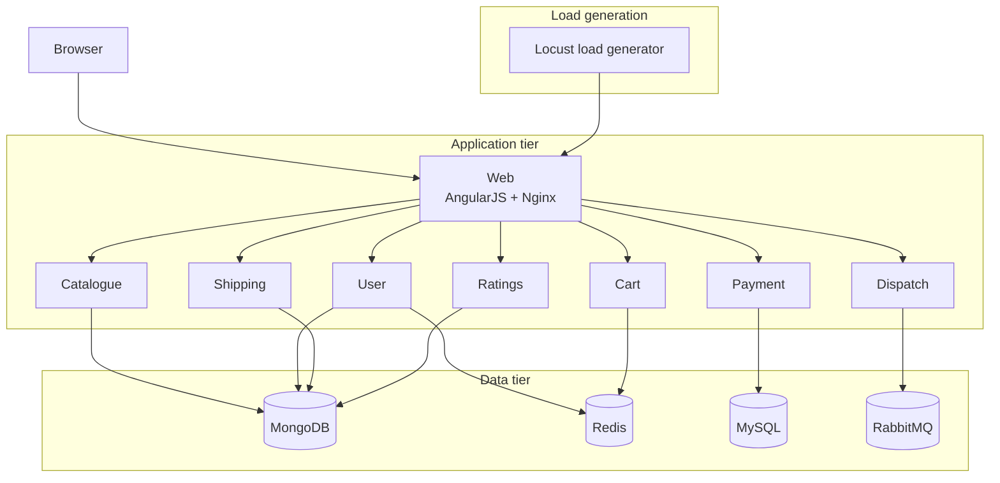

# Three-Tier Microservices on AWS EKS

A hands-on deployment lab built around **Stan's Robot Shop**, a polyglot microservices storefront. The repository captures the three-tier topology used for the exercise: a web front end, a set of application services, and a data tier with MongoDB, Redis, MySQL and RabbitMQ.

The goal is operational rather than product-focused: run the same stack locally with Docker Compose, then move it to a Kubernetes cluster on AWS EKS.

> **Local demo:** <http://localhost:8080> after `docker compose up --no-build`  
> **Cloud target:** AWS EKS with images stored in Amazon ECR

## Architecture



| Tier | Services | Responsibility |
| --- | --- | --- |
| Web | `web` | AngularJS storefront served by Nginx on port 8080 |
| Application | `catalogue`, `user`, `cart`, `shipping`, `ratings`, `payment`, `dispatch` | Product, account, basket, fulfilment, reviews, checkout and order routing |
| Data | `mongodb`, `redis`, `mysql`, `rabbitmq` | Catalogue and user documents, sessions and cart state, payment records, async order messages |

The services are written in Node.js, Java, Python, Go and PHP. This is a teaching application: error handling and security are intentionally thin, so do not treat it as a production reference.

## What is in this repository

| Path | Purpose |
| --- | --- |
| `docker-compose.yaml` | Full three-tier stack, networks, health checks and log limits |
| `docker-compose-load.yaml` | Optional Locust load generator attached to the same network |
| `.env` | Image registry and tag used by Compose (`robotshop`, `2.1.0`) |
| `pullbaseimages.sh` | Pulls the base images referenced by any local Dockerfiles |
| `LICENSE` | Apache 2.0 |

The published service images live under the `robotshop` Docker Hub organisation. The upstream application source and its Kubernetes/Helm manifests are maintained in the [Stan's Robot Shop](https://github.com/instana/robot-shop) project; this repository keeps the Compose deployment layer used for the lab.

## Run locally

Requirements: Docker Desktop or Docker Engine with Compose v2.

```bash
docker compose pull
docker compose up --no-build
```

Open <http://localhost:8080>.

To include continuous load:

```bash
docker compose -f docker-compose.yaml -f docker-compose-load.yaml up --no-build
```

Stop the stack:

```bash
docker compose down
```

Check the running services:

```bash
docker compose ps
docker compose logs -f web
```

## Deploy to AWS EKS

The Compose stack maps directly to a Kubernetes deployment:

1. **Images** — build or pull each service image and push it to Amazon ECR. Replace the `robotshop` registry in `.env` with your ECR repository prefix.
2. **Cluster** — create an EKS cluster and configure `kubectl` for it.
3. **Workloads** — create a namespace, then deploy each service as a Deployment and the storefront as a LoadBalancer Service. Add the data tier as StatefulSets or point the services at managed databases.
4. **Configuration** — move connection strings and credentials into ConfigMaps and Secrets. Do not commit them.
5. **Expose** — read the web Service's external hostname and open it in a browser.
6. **Observe** — check pod status, Service endpoints and application logs before generating load.

The Compose file is the source of truth for service names, ports and data-store connections. Cluster manifests are intentionally not checked in here; add them under `k8s/` for a reproducible EKS deployment.

## Load generation

`docker-compose-load.yaml` starts the Locust-based generator against `http://web:8080`. Use it to watch the stack under traffic while tuning resources or readiness probes.

## Credit

The application is **Stan's Robot Shop**, published by Instana as a microservices and observability sandbox. See the [upstream project](https://github.com/instana/robot-shop) and the [original blog post](https://www.instana.com/blog/stans-robot-shop-sample-microservice-application/). This repository packages the deployment exercise around it.

## License

Apache 2.0. See [LICENSE](LICENSE).
